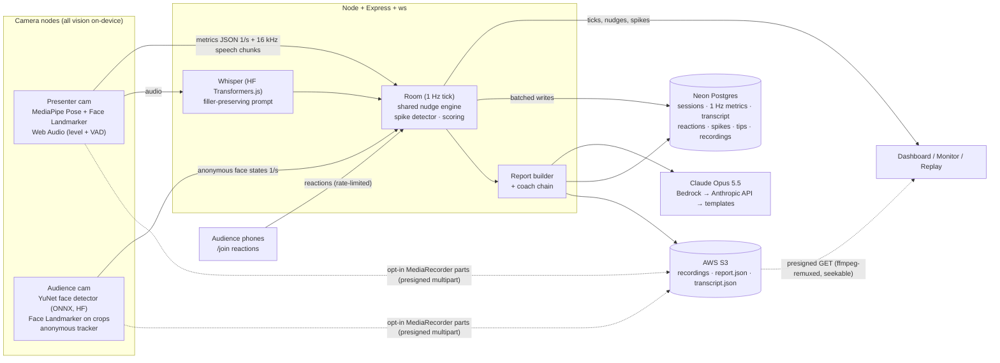

# CrowdSense

**Live presentation coaching from two cameras.** One camera watches you and one watches your audience, and every frame is analyzed privately in the browser. While you speak you get one quiet, explainable nudge at a time ("The right side is drifting. Look over there.", "Speak up.", "You've been looking at your screen for 40s."). Afterward you get a report with AI coaching and a synced replay you can compare against your last session.

> Audience signals are **engagement estimates** from head pose and facial movement. They are not emotion detection, mind reading, or identification.

---

## Who this helps and what problem it solves

Presenters can't see themselves and can't easily read a whole room while talking. Feedback usually arrives too late, as a survey a week later, and it's too vague ("it was a bit long"). That hurts most for:

- **Students and early-career speakers** rehearsing for class talks, defenses, interviews and pitches. They practice alone with no audience, so Practice Mode gives them a virtual one that reacts.
- **Teachers and lecturers**, who lose the back row or one side of a lecture hall without noticing. The room map and zone alerts catch it while there's still time to recover.
- **Non-native speakers and anxious presenters**, who speed up, fill silences with "um", and stare at their notes. Pace, filler and eye-contact nudges are private: only the presenter sees them.
- **Hackathon and demo-day teams**, who get 3 minutes and one shot. They can rehearse with scores, streaks and progress across runs.

The core idea is to close the feedback loop *during* the talk, with signals that are measured, explainable, and private by design.

---

## Quick start

```bash
npm install          # also downloads the MediaPipe + YuNet models into .cache/models
npm run dev          # API on :8787, web on http://localhost:5173
```

Everything runs with **zero keys**. Missing integrations fall back automatically, and the dashboard's "Connect devices" panel shows what is live. Copy `.env.example` to `.env` to switch integrations on.

| Command | What it does |
|---|---|
| `npm run dev` | Server (tsx watch) + Vite, with hot reload (polls on WSL `/mnt/*` drives) |
| `npm run dev:lan` | Same, over **HTTPS** so phones on your network can use their cameras |
| `npm run simulate` | Drives a full synthetic room (presenter, audience, phones, speech) with **no cameras**, for dashboard/report development |
| `npm run s3:setup` | One-time: applies bucket CORS so browsers can upload recording parts to S3 |
| `npm run build && npm start` | Production: one port serves app + API + WebSockets (see `Dockerfile`) |
| `npm run typecheck` | TypeScript across server, shared, and web |

Requirements: Node 20+ and a Chromium-based browser for the camera nodes (Chrome, Edge, or Android Chrome). Safari works for phones' reaction pages.

### Running a session

1. Open **http://localhost:5173** and click **Start a live session**. This opens the dashboard with QR codes.
2. **Presenter camera:** open the presenter link on the laptop facing you (or the phone on a stand). Accept the consent screen, step into frame, and talk for 15 seconds. Calibration captures *your* baseline posture, head angle and volume.
3. **Audience camera:** open the audience link on a second webcam or phone, placed beside you and facing the room. No crowd? Choose **Simulated room** or **loop a video file**. For a built-in demo clip, drop any crowd video at `web/public/demo/audience-loop.mp4`.
4. **Phones:** the audience scans the QR to tap *Lost me / Too fast / Love this / Question* anonymously (once per 10 s).
5. Press **Start session** and present. Optionally toggle **Record video** (off by default; every camera shows REC).
6. Press **End session**, then open the **Report** and the synced **Replay**.

**One laptop, two webcams:** on the home page, use "Open all three views at once".

### Phones over LAN, WSL, or tunnels

Browsers only grant camera/mic access on `https://` or `localhost`.

- **LAN:** `npm run dev:lan` serves a self-signed HTTPS cert. Accept the warning once on each phone. The dashboard's QR codes use your LAN IP.
- **WSL2:** the default NAT network is not reachable from phones. Either enable mirrored networking (`[wsl2] networkingMode=mirrored` in `%UserProfile%\.wslconfig`, then `wsl --shutdown`), or use a tunnel.
- **Tunnel:** `cloudflared tunnel --url http://localhost:5173`, then set `PUBLIC_URL=https://<name>.trycloudflare.com` in `.env` so the QR codes point at it.

Reaction pages (`/join`) don't need a camera, so plain HTTP is fine for them.

---

## Architecture



**What crosses the network:** per-second anonymized metrics (numbers only), the presenter's speech audio to *your own* server for Whisper, reaction taps, and recordings only when someone turns recording on. Raw video never streams between devices.

### Code map

```
shared/        Types, thresholds, nudge engine, spike detector, scoring, virtual audience (used by browser AND server)
server/        Express + ws: rooms, Whisper, Neon/local repo, S3/local blobs, report builder, AI providers
  ai/          whisper.ts · coach.ts (template) · claude.ts (Bedrock/Anthropic) · tts.ts (ElevenLabs) · review.ts (Gemini, Rekognition)
  db/          schema.sql · neon.ts · repo.ts (interface + LocalRepo fallback)
web/src/
  vision/      presenter.ts · audience.ts · yunet.ts · geometry.ts (head pose) · mediapipe.ts
  audio/       mic.ts (level, noise floor, VAD chunker) · webspeech.ts
  rec/         useRecorder.ts (MediaRecorder → 5 MB multipart parts)
  pages/       Home · Camera (Presenter/Audience nodes) · Dashboard · Monitor · Join · Practice · Report · Replay
  ui/          tokens.css (design system) · Timeline · room map/heatmap · VirtualRoom
scripts/       fetch-models · simulate · s3-setup · dev-server
```

### WebSocket protocol (`shared/types.ts`)

- **Client → server:** `hello{role,code}`, `ping`, `presenter.sample`, `presenter.baseline`, `audience.sample`, `speech.webspeech`, `reaction{kind,text?}`, `control{start|end|recording}`, and binary 16 kHz PCM speech chunks (16-byte header).
- **Server → client:** `welcome{session,config}`, `pong` (clock sync), `session`, `tick` (merged 1 Hz state), `nudge`, `spike`, `transcript`, `reaction`, `reaction.limited`, `report.ready`.

### Metrics and thresholds (all in `shared/thresholds.ts`)

| Signal | How it's measured | Nudge when |
|---|---|---|
| Audience attentive | head yaw within ±32°, pitch within the room's calibrated range, eyes open | n/a |
| Looking down | pitch more than 18° below the room's median | ≥50% of a zone down for 45 s: "Front-left has been looking down for 45s. Engage them." |
| Side drift | left/right third attention <45% and 20 points below the other side | 12 s: "The right side is drifting. Look over there." |
| Lost moment (spike) | attention −25 points in 12 s, 30% confusion-like brows for 3 s, or ≥2 "Lost me" taps in 20 s | immediate nudge + timeline marker |
| Slouch / tilt / forward head | torso ratio, shoulder angle, face-to-shoulder ratio **vs your baseline** | 8–10 s sustained |
| Sway / pacing / fidget | oscillation of body x, travel per 10 s, wrist jitter above pose-noise floor | 15–20 s sustained |
| Eye contact / screen gaze | head pose vs the direction you faced during calibration | screen ≥40 s; one side neglected for 45 s |
| Volume | speech dBFS vs calibrated speaking level (AGC off) | −6 dB for 5 s: "Speak up." |
| Pace | words ÷ speaking time over 30 s (Web Speech if on, else Whisper) | >172 wpm for 12 s; <105 for 20 s |
| Fillers | um/uh/erm/ah, "you know", "I mean", "basically", comma-delimited "like" | >6 per speaking-minute |

Nudges have a **30 s cooldown per type**, a **10 s global gap**, and a priority order (audience > voice > eyes > posture), so only one shows at a time. Every nudge prints the metric that triggered it. Set `NUDGE_SPEED=demo` to halve the hold times for a short demo.

**Delivery score (0–100):** eye contact 25, pace 20, fillers 15, volume 15, posture 15, movement 10. The same function scores live sessions, reports, and Practice Mode.

---

## Sponsor technology

| Sponsor | What we use | Where | Without a key |
|---|---|---|---|
| **Hugging Face** | **Whisper** (`onnx-community/whisper-base.en`) runs on the server via Transformers.js/ONNX Runtime. The decoder is prompted with filler-rich text (`<\|startofprev\|>Umm, let me think like, hmm…`) so it *keeps* "um/uh" instead of cleaning them up. That's what live filler counts depend on. | `server/ai/whisper.ts` | Always on (open weights, downloads once). `WHISPER_ENABLED=0` falls back to the Web Speech API. |
| **Hugging Face** | **OpenCV YuNet** face detector (`opencv/face_detection_yunet`, MIT), run **in the browser** with ONNX Runtime Web. It finds the small, distant faces that MediaPipe's short-range detector misses: on a 29-person group photo it found all 29, versus 3 with tiled MediaPipe. | `web/src/vision/yunet.ts` | Always on |
| **Neon** | Serverless **Postgres is the system of record**: anonymous presenters, sessions, 1 Hz metric rows (batched, never per frame), transcript segments, reactions (salted client hashes), spike events, coaching tips, recording references. Past-session comparison reads from it. | `server/db/schema.sql`, `server/db/neon.ts` | JSON files in `.data/` |
| **AWS S3** | Opt-in recordings upload **directly from each camera node** through presigned multipart URLs (5 MB parts). The server remuxes them with ffmpeg so WebM is seekable, and replay streams them back via presigned GET. Report and transcript JSON are stored per session. | `server/storage.ts`, `server/routes/recordings.ts`, `web/src/rec/useRecorder.ts` | Signed local-disk endpoints with the same flow |
| **AWS Bedrock** | **Claude Opus 5.5** writes the post-session coaching (headline, strengths, ranked improvements tied to timestamps, a drill) from metrics, lost moments, transcript and history, as schema-validated JSON. | `server/ai/claude.ts` | Anthropic API, then rule-based templates |
| **AWS Rekognition** | *Optional cross-check.* Rekognition Video face **detection** (pose and eyes only: no collections, no identity search) on the recorded audience video recomputes attention, and the report shows the mean difference and correlation against the live browser estimates. | `server/ai/review.ts` | Button hidden |
| **Anthropic API** | Same coaching prompt as Bedrock, with server-side refusal fallback (`fallbacks: "default"`). | `server/ai/claude.ts` | Rule-based templates |
| **Google Gemini** | *Optional.* Multimodal review of each lost moment from a **presenter** keyframe (ffmpeg) plus transcript plus metrics: likely cause and a concrete fix. Audience frames are never sent; the audience is described by anonymous numbers only. | `server/ai/review.ts` | Button hidden |
| **ElevenLabs** | *Optional.* Spoken nudges on the Confidence Monitor and a 45-second spoken post-session debrief. | `server/ai/tts.ts` | Browser speech synthesis |
| Presage | Not implemented. Presage's vitals SDK isn't a drop-in browser package, so we left it out rather than fake it. | n/a | n/a |

Also on-device: **MediaPipe** Pose Landmarker (presenter) and Face Landmarker (presenter, plus audience face crops for pose and blendshapes).

---

## 60-second demo script

*Setup before you start: the dashboard is on the projector, the presenter laptop faces you, the audience cam (or **Simulated room**) is ready, and two teammates have phones on the join page. Optionally set `NUDGE_SPEED=demo`.*

| Time | Do | Say |
|---|---|---|
| 0:00 | Dashboard on screen, QR codes visible | "Presenters can't see their own delivery or the whole room. CrowdSense watches both, privately." |
| 0:08 | Point at the room map | "Every dot is an anonymous person: an engagement estimate from head pose, computed in the browser. No video leaves the device and there's no face recognition." |
| 0:15 | Start the session and speak normally | "My camera calibrated to *my* posture and *my* volume, so everything is judged against my baseline." |
| 0:22 | Look down at your laptop and keep talking | (The monitor shows "You've been looking at your screen…" or the room map drifts.) |
| 0:30 | A teammate taps **Lost me** twice | "The audience can tell me too, anonymously." A spike lands on the timeline with what I was saying. |
| 0:38 | Say "um, like, you know" a few times | "Whisper keeps the ums, because we prompt it to. The filler count climbs and I get one nudge: *Pause instead of filling.*" |
| 0:45 | End the session and open the report | "Claude on Bedrock turns the data into coaching tied to exact moments, compared with my last run." |
| 0:52 | Click a lost moment to open the replay | "Both videos, the transcript and the room map are synced. Here's exactly where I lost them." |
| 0:58 | | "CrowdSense: practice with a virtual audience, present with a private coach." |

No crowd? Run the audience node with **Simulated room**, or run `npm run simulate`. The simulator scripts a right-side drift, a screen-gaze stretch, "Lost me" taps and a question.

---

## Privacy guardrails

- **Consent first:** every camera page shows a consent screen before any camera turns on, explaining what is and isn't processed.
- **Visible indicators:** "Camera on · Mic on" is always shown, and **REC** shows on every camera while recording.
- **No identification:** no face recognition, embeddings, or identity. Audience faces become dots with counter IDs assigned by position, discarded each session. The audience preview is blurred by default and can be hidden.
- **Only anonymized metrics leave the device.** The one exception is the presenter's own voice, which goes to the session's own server for Whisper. The optional "browser speech" pace mode uses the browser vendor's speech service and says so where you turn it on.
- **Recording is opt-in** (off by default) and per session. Gemini review sends only presenter frames, never audience frames.
- **No accounts:** the presenter is a random ID in localStorage, and phones get a random ID used only for rate limiting (stored salted and hashed).

---

## Limitations

- **Attention is estimated from head pose and eye openness.** Someone looking at the slides beside you can read as "away", and someone listening while looking down at notes reads as "down". Treat it as a room-level trend, not a per-person verdict.
- **Distance and resolution:** accuracy drops with small faces (under ~25 px), low light, strong backlight, masks, or steep camera angles. YuNet finds small faces, but head-pose and blendshape quality degrade on tiny crops. Faces beyond the landmark budget use coarser 5-keypoint pose. Use "2 tiles" or "4 tiles" coverage in large rooms.
- **Room calibration** assumes most people are attentive during the first ~8 s after faces appear. Recalibrate if the room starts distracted.
- **Confusion-like expressions** (brow lowering relative to each face's own resting brow) are a weak signal, used only for spikes.
- **Tracking** is position-based: people who swap seats or leave and return get new IDs. Dense crowds can merge tracks.
- **Presenter metrics** need face and shoulders in frame. A presenter facing away is counted as looking "away". Fidget and sway are heuristics with noise floors.
- **Whisper latency** is ~1–3 s per utterance on a laptop CPU (base.en). `whisper-tiny.en` is faster but less accurate. Filler recall is good but not perfect, and "like" only counts when comma-delimited.
- **Web Speech** pace (optional) depends on the browser vendor's cloud service and drops fillers, so fillers always come from Whisper when it's available.
- **Clock sync** between nodes is NTP-style over WebSocket (typically within ±50 ms). Replay drift correction snaps videos within 300 ms.
- Sessions live in server memory while active. Restarting the server mid-session ends live rooms, though data already persisted stays.
- Practice Mode's virtual audience is a model of how audiences tend to react to delivery. It is a rehearsal aid, not a prediction for a real room.

---

## What we tested

Headless Chromium with fake camera/mic devices (a public-domain portrait, a 29-person group photo, and a speech clip) exercised: presenter calibration, live metrics, Whisper transcription, audience detection (31 tracks), dashboard, monitor, phone rate limiting, spikes and nudges, Neon persistence (against real Postgres via PGlite), report with history comparison, Practice Mode runs, MediaRecorder upload, ffmpeg remux (`Duration: N/A` → `39.6 s`), and synced replay seeking. Bedrock, Anthropic, Gemini, ElevenLabs, S3 and Rekognition calls are written against their SDKs/APIs and fail over gracefully, but they need real keys to verify end to end.

### Hosted speech transcription (Hugging Face)

Create a fine-grained token at https://huggingface.co/settings/tokens with **Make calls to Inference Providers** permission. Save it only in the server environment (local `.env` for development; `/etc/read-the-room.env` for the deployed app):

```dotenv
HF_TOKEN=
HF_ASR_ENABLED=1
HF_ASR_MODEL=openai/whisper-large-v3
```

Restart the server after configuring it. Never put the token in frontend/Vite variables or commit it. Inference provider access, available models, and usage credits depend on your Hugging Face account.

Hosted speech sends 16 kHz mono WAV chunks to HF Inference when `HF_ASR_ENABLED=1` and `HF_TOKEN` is set. Failed requests fall back to local Whisper. Keep `WHISPER_ENABLED=1` for local fallback.

### Gemini report coaching

Set `GEMINI_API_KEY` in the server environment. `GEMINI_COACH_MODEL` defaults to `gemini-flash-latest`. Reports send session metrics and transcript excerpts to Gemini. Hugging Face is no longer used for report coaching. Initial reports can use rule-based coaching when Gemini is unavailable; Regenerate reports an error and preserves the previous report if Gemini fails. Restart the service after changing environment settings.

For Google Cloud billing through Vertex AI, set `GEMINI_BACKEND=vertex`,
`GOOGLE_CLOUD_PROJECT` to your billing-linked project, `GOOGLE_CLOUD_LOCATION=global`,
and `GEMINI_COACH_MODEL=gemini-3.8-flash`. The server uses Google's Application Default
Credentials. On AWS, configure a workload identity credential or set
`GOOGLE_APPLICATION_CREDENTIALS` to a private credential file outside the deployed
source tree. Grant the application only the required Vertex AI access. Keep credential
files out of Git and browser code; `.credentials/` is ignored for local setup.
Both coaching and presenter-frame review use the selected backend. A Vertex
authentication failure never falls back to AI Studio. Restart after changing settings.
